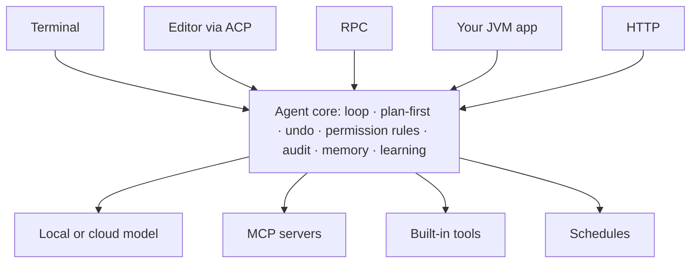

<div align="center">


# SoPhi

### Your AI agent, on your machine.

It plans before it changes things, asks before anything risky, and can undo what it did.

[](https://kotlinlang.org)
[](https://adoptium.net)
[](#-for-developers)
[](LICENSE)
[](docs/extending.md)
[](docs/editors-and-rpc.md)



```bash
curl -fsSL https://raw.githubusercontent.com/shukriev/SoPhi/main/scripts/get-sophi.sh | sh
```

Works with **Ollama · LM Studio · llama.cpp · any OpenAI-compatible server**, or Claude with your own key.
SoPhi never picks a cloud model for you.

</div>

---

## Who is this for?

<table>
<tr>
<td width="33%" valign="top">

### [🛠 Developers →](#-for-developers)
Run it in your terminal or your editor, drive it over JSON from any language, or embed it in your JVM app.

</td>
<td width="33%" valign="top">

### [🧭 Product owners →](#-for-product-owners)
What it does for people today (errands, schedules, watching pages, a morning briefing) and how it stays safe.

</td>
<td width="33%" valign="top">

### [🏢 Enterprises →](#-for-enterprises)
Your hardware, your models. Permission rules, sandbox, audit log, secrets in the keychain, pinned plugins.

</td>
</tr>
</table>

---

## 🛠 For developers

<details open>
<summary><b>One agent, five ways to run it</b></summary>
<br>

| Where | How | Guide |
|---|---|---|
| 💻 Terminal | `sophi` — chat, `/goal`, `/plan`, `/undo`, `/settings` | [docs/cli.md](docs/cli.md) |
| ✏️ Your editor (Zed, any ACP client) | `sophi --mode acp` | [docs/editors-and-rpc.md](docs/editors-and-rpc.md) |
| 🔁 Any language, over JSON lines | `sophi --mode rpc` | [docs/editors-and-rpc.md](docs/editors-and-rpc.md#over-json-lines-rpc) |
| 🧩 Inside your JVM app | `sophi-sdk` | [docs/sdk.md](docs/sdk.md) |
| 🌐 Over HTTP | `sophi-web` — REST + SSE | [docs/http.md](docs/http.md) |

All five share the same agent loop, tools, sessions and safety checks, so moving between them doesn't change behaviour.

</details>

<details>
<summary><b>Embed it in three lines</b></summary>
<br>

```kotlin
val runtime = Sophi.runtime {
    provider = buildOpenAiCompatProvider(baseUrl = "http://localhost:11434/v1", apiKey = null, model = "qwen3:8b")
}
val sessionId = runtime.newSession(title = "release-check")
println(runtime.turn(sessionId, "What changed since the last tag?"))
```

Add your own tools, grants, plugins, plan-first, undo and an audit log from the same builder. See [docs/sdk.md](docs/sdk.md).

</details>

<details>
<summary><b>Extend it: MCP servers, skills, plugins, hooks</b></summary>
<br>

- **MCP servers** in `.sophi/mcp.json`: any MCP server's tools, with OAuth sign-in (`sophi mcp login <server>`) and keys from the keychain (`${secret:name}`). Large servers load their tools on demand.
- **SoPhi as an MCP server:** `sophi mcp-serve`.
- **Skills:** Markdown files with a short header; installs are pinned and scanned (`sophi skill install`).
- **Plugins from git:** `sophi install git:<url>[#ref]`, pinned to a commit and the jar's SHA-256, shown before you confirm.
- **Hooks:** before/after each turn and tool call; a hook can veto or rewrite a tool call.

More in [docs/extending.md](docs/extending.md).

</details>

<details>
<summary><b>How it fits together</b></summary>
<br>



More in [doc/Architecture.md](doc/Architecture.md).

</details>

<details>
<summary><b>All 19 modules</b></summary>
<br>

| Module | What it gives you |
|--------|--------------------|
| ⚡ `sophi-ai` | Model providers: local servers, any OpenAI-compatible API, Claude; model catalog and cost |
| 🧠 `sophi-core` | The agent loop, session tree, tools, compaction, plan-first, undo, permission rules, audit |
| 📚 `sophi-skills` | Skills from Markdown files with YAML frontmatter |
| 🔌 `sophi-extensions` | Plugins and lifecycle hooks |
| 🎓 `sophi-learning` | Tool reliability, lessons from past sessions, feedback, fine-tuning dataset export |
| 🗄️ `sophi-store` | Embedded ArcadeDB (document + graph + vector), the storage under memory and versioning |
| 🕰️ `sophi-versioning` | Version history and revert for skills, lessons, configs and agent definitions |
| 🏛️ `sophi-memory` | Long-term memory (Jane's Theory) |
| 🔎 `sophi-context` | Indexes your projects for `search_context` (`sophi context add <folder>`) |
| 🔗 `sophi-mcp` | MCP client and server |
| 📡 `sophi-hub` | Local WebSocket hub so a desktop app can watch and steer CLI sessions |
| ⏰ `sophi-schedule` | Recurring, goal and page-watch tasks, the scheduler, the briefing |
| 📅 `sophi-calendar` | Calendar tools (macOS) |
| 🚪 `sophi-gateway` | Message contract between chat services and a SoPhi host |
| 💬 `sophi-gateway-discord` | Discord bot: text, voice messages, photos, approval buttons |
| 💻 `sophi-cli` | The `sophi` command |
| 🌐 `sophi-web` | REST + SSE server |
| 🛠️ `sophi-sdk` | `Sophi.runtime { }` for embedding, plus the ACP and RPC servers |
| 🏗️ `sophi-infra` | Ready-made plugins (`MetricsPlugin`) |

</details>

<details>
<summary><b>Install options and building from source</b></summary>
<br>

Installers (no Java needed), the one-liner for Windows, pinning a version, and `mvn -q -DskipTests package`:
see [docs/install.md](docs/install.md). Then run `sophi doctor` to check the model server, settings, MCP
servers and skills, with one fix line per problem.

</details>

---

## 🧭 For product owners

<details open>
<summary><b>What people use it for</b></summary>
<br>

| | |
|---|---|
| 📅 **Daily errands** | Calendar, files, onboarding and offboarding people across the systems you connect |
| ⏰ **Schedules** | "Every weekday at 9, check X." It stays quiet unless there's something to tell you. [More](docs/schedules.md) |
| 👀 **Watch a page** | Tells you when a page's text changes, not when its clock does |
| ☀️ **Morning briefing** | `sophi briefing`: what ran while you were away, and what's waiting for you |
| 🎯 **Goals** | `/goal`: plans the steps, runs them, checks the result, replans if it's not done |
| 🧠 **Remembers and learns** | Long-term memory of your world, and lessons from what worked and what you corrected. [More](docs/learning-and-memory.md) |
| 📄 **Share a session** | `sophi export --html <id>`: one self-contained page, secrets removed |

</details>

<details open>
<summary><b>Why it's safe to hand real work to</b></summary>
<br>

| | |
|---|---|
| ✋ **Plan first** | Changes to other systems are held as one plan until you approve it, then replayed exactly as shown |
| 🙋 **Asks first** | Risky commands need your yes; your own rules decide what's always allowed or never |
| ↩️ **Undo** | Files it changed, moved or deleted can be put back (`/undo`); a shell command reaching outside the project is flagged as not undoable |
| 🌙 **Unattended means limited** | Scheduled runs can't do what you didn't grant, and can be kept to the accounts you picked |
| 📜 **Audit log** | Every tool call: what, when, who decided, with secrets removed |

</details>

<details>
<summary><b>Try these</b></summary>
<br>

```text
Every morning at 8, tell me if any of tomorrow's meetings moved.
Watch https://example.com/pricing and tell me when it changes.
Move every PDF in ~/Downloads older than 30 days into ~/Archive/PDFs.
Offboard jane@acme.com: suspend her accounts and archive her project folder.
/goal get the build green and keep it under 10 minutes
```

</details>

<details>
<summary><b>Want it in your menu bar?</b></summary>
<br>

**SoPhi Companion** is a desktop app built on this SDK: chat, sessions, goals, approvals and the morning briefing,
one click away. It's a separate commercial product; see [sophiloop.com](https://sophiloop.com). The last open-source
snapshot is the [`companion-last-oss`](https://github.com/shukriev/SoPhi/tree/companion-last-oss/sophi-companion) tag.

</details>

---

## 🏢 For enterprises

| Concern | What SoPhi does |
|---|---|
| 🏠 **Data stays in** | Runs on your machines with local models; a cloud model is used only if you configure one |
| 🔐 **Who may do what** | Allow / ask / deny rules per tool, command and path, global and per project; project rules from a cloned repo are inactive until trusted |
| 📦 **Containment** | Commands can run in the macOS sandbox or a Docker container, with the network off |
| 📜 **Evidence** | Append-only audit log of every tool call with secret redaction; plan replays are logged step by step |
| 🔑 **Secrets** | OS keychain, referenced as `${secret:name}`; masked in MCP results the model sees; OAuth sign-in for MCP servers |
| 🧾 **Supply chain** | Skills and plugins pinned to a commit (plugins also to a SHA-256) and shown before install |
| 🧪 **Untrusted input** | Optional model checks: `read-check` reviews web and MCP results for injected instructions (record only, or hold them); `guardian` reviews destructive calls before they run |

<details>
<summary><b>Deploying it</b></summary>
<br>

- **As a service:** `sophi-web` (Spring Boot, REST + SSE). See [docs/http.md](docs/http.md).
- **Unattended work:** the scheduler as a daemon, launchd or cron. See [docs/schedules.md](docs/schedules.md).
- **Inside your own systems:** the SDK, or the RPC protocol from any language. See [docs/sdk.md](docs/sdk.md) and [docs/editors-and-rpc.md](docs/editors-and-rpc.md).
- **Details and known limits** of rules, sandbox and audit log: [docs/cli.md](docs/cli.md).

</details>

<details>
<summary><b>Need SSO, roles or support?</b></summary>
<br>

The core, SDK and web API are Apache 2.0 and stay that way. For support contracts or features your company
needs (SSO, roles, tenants, audit retention), open a [discussion](https://github.com/shukriev/SoPhi/discussions)
or write through [sophiloop.com](https://sophiloop.com).

</details>

---

## 🤝 Contributing

Research, features, fixes and docs are all welcome. Start with [CONTRIBUTING.md](CONTRIBUTING.md),
[GOVERNANCE.md](GOVERNANCE.md) and the [Code of Conduct](CODE_OF_CONDUCT.md). Before a PR: `mvn test` passes and
`CHANGELOG.md` has an entry under `[Unreleased]`. Questions go to [issues](https://github.com/shukriev/SoPhi/issues)
or [discussions](https://github.com/shukriev/SoPhi/discussions).

## 📄 License

[Apache 2.0](LICENSE).
